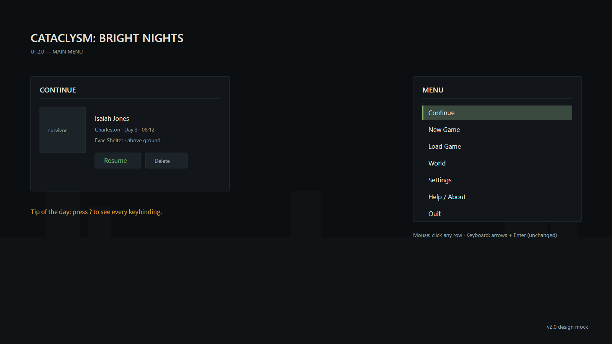
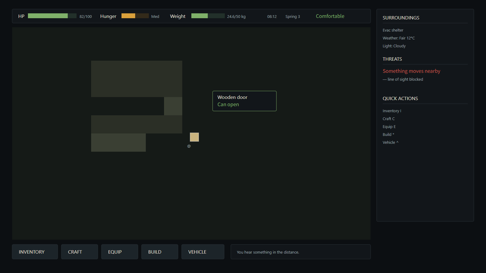
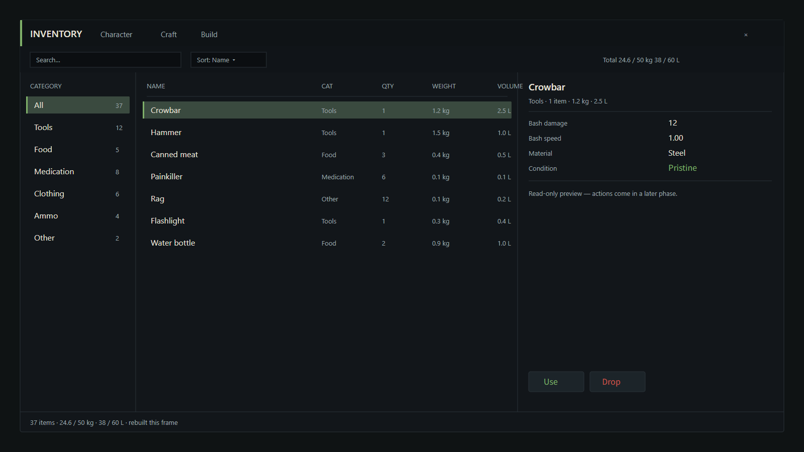

# CBN UI 2.0 全面重设计 · 合订本

> 生成时间：2026-11-21 · 项目：Cataclysm: Bright Nights · UI 2.0 全面重设计第一阶段交付
> 本文件由五份独立文档合并，供外部审阅；原始文件保存在 CBN-Development\docs\ 下。

## 目录

- 一、现状审计
- 二、产品需求与交互方案
- 三、视觉设计规范
- 四、技术架构方案
- 五、开发路线与验收标准


---

# 一、现状审计

# CBN UI 2.0 全面重设计 · 现状审计

2026-11-21 · 仅审计，未修改任何源码 · 依据本地实测与源码阅读

## 一、三个仓库状态（审计时刻）

| 仓库 | HEAD | 工作区 | 最近提交 |
| --- | --- | --- | --- |
| `规则` | `1c81383` | 干净 | PR-2A AIM-1 标记为待验收 |
| `repo` | `2a474e1` | 干净 | `imgui_aim` action 入口 |
| `docs` | `1b1073d` | 干净 | AIM-1 实施记录 |

**未提交/在建内容：无。** AIM-1（`7c406a0`）与入口（`2a474e1`）都已提交，工作区干净，不存在需要抢救的改动。

已有成果全部在 Git 历史中，可回退：PR-1 `889c052`、PR-1.5 A/B/C/D `48e05d2`/`4184e65`/`b4d46a4`/`852a55a`、DPI 修正 `432f77b`、AIM-1 `7c406a0`、入口 `2a474e1`。

## 二、现有界面清单（代码实测）

| 界面 | 源文件 | 行数 | 打开方式 |
| --- | --- | --- | --- |
| 主菜单 | `main_menu.cpp` | 1,210 | 启动 |
| 新角色/世界创建 | `newcharacter.cpp` / `worldfactory.cpp` | 4,797 / 1,648 | 主菜单 New Game / World |
| 游戏地图 | `sdltiles.cpp` + `map` | — | 进入世界后常驻 |
| 侧边栏 HUD | `panels.cpp` | 3,022 | 常驻（可配置面板） |
| 消息日志 | `messages.cpp` | 938 | 常驻消息区 / `messages` 动作 |
| 背包（列表式） | `game_inventory.cpp` | 2,341 | `inventory` |
| 先进物品管理 AIM | `advanced_inv*.cpp` | 1,930 + 470 + 282 + 73 | `advinv`（`/`） |
| 通用物品选择器 | `inventory_ui.cpp` | 2,840 | 到处被调用 |
| 装备/穿脱/护甲层 | `character.cpp`、`armor_layers.cpp` | 13,264（Character 总量） | `wear` / `take_off` / `sort_armor` |
| 制作 | `crafting_gui.cpp` / `crafting.cpp` | 2,144 / 2,599 | `craft` / `recraft` / `long_craft` |
| 建造与拆除 | `construction.cpp` | 2,493 | `construct` / `disassemble` / `salvage` |
| NPC 对话 | `npctalk.cpp` | 3,941 | `chat` |
| 势力/任务 | `faction.cpp` / `mission_ui.cpp` | 911 / 219 | `factions` / `missions` |
| Zone 管理 | `clzones.cpp` | 1,627 | `zones` |
| 变形/义体/变异 | `bionics.cpp`、`bionics_ui.cpp` | 3,263 / 968 | `bionics` / `mutations` |
| 载具交互 | `veh_interact.cpp` | 见源码 | `control_vehicle` |
| 设置 | `options.cpp` | — | `open_options`，分页 General / Interface / Graphics / Debug |
| 键位设置 | `input.cpp` 键位 UI | — | `?`（`HELP_KEYBINDINGS`） |
| UI 2.0 覆盖层（新） | `cata_imgui*.cpp`、`cata_imgui_ui2*.cpp` | ~1,900 | `F10`、`imgui_aim` |

游戏内可执行动作共 **158 个**（`action.cpp` 的 `action_ident()` 清单），覆盖移动、战斗、物品、建造、载具、调试等全部功能。

## 三、现有交互方式的实测结论

| 事实 | 证据 |
| --- | --- |
| 主菜单**不支持鼠标点击** | `main_menu.cpp:672-681` 只注册 `NEXT_TAB/PREV_TAB/PAGE_UP/PAGE_DOWN/CONFIRM/QUIT/ANY_INPUT`，无 `SELECT`；鼠标左键在 CBN 里映射为 `SELECT` |
| 主菜单支持滚轮 | 处理分支含 `SCROLL_UP/SCROLL_DOWN` |
| 游戏内鼠标仅能"选择/移动" | `MOUSE_LEFT → SELECT`，右键 → `SEC_SELECT`；没有悬停、没有拖拽、没有右键菜单 |
| 全部管理界面都是 ncurses 字符界面 | 背包、AIM、制作、建造、对话、Zone 等全部是 `catacurses` 窗口 |
| 界面之间没有统一导航 | 每个界面自己处理 Esc/退出，互相不能跳转（如从制作界面直接去背包） |
| 没有全局搜索 | 只有制作界面有配方过滤 |
| 信息密度极高 | 背包单屏约 20 行，AIM 双窗格 + 迷你地图，制作界面 3 列 + 页签 |
| 新 UI 目前只是演示 | 覆盖层里 5 个窗口 + AIM-1 只读背包，未被任何真实流程使用 |

## 四、玩家实际痛点（基于上述机制推导）

1. **入口不可发现**：158 个动作、几十个界面，玩家只能靠键位表（`?`）记忆。想找"怎么给车装货"没有路径。
2. **鼠标几乎无用**：除主菜单滚轮外，鼠标只能点地图移动。整理背包、制作、穿装备全部要键盘。
3. **界面割裂**：背包→制作→建造→对话是四个独立界面，物品在它们之间无法直接流转（只能退出再进）。
4. **窗口不可组合**：想看背包同时看地图？做不到，管理界面全屏覆盖地图。
5. **信息呈现单一**：只有字符表，没有图标、没有图表、没有可视化重量/体积占用。
6. **中文体验差**：字符界面下中文靠等宽字体对齐，列宽错乱是常态。

## 五、业务能力映射（界面 → 业务 → 数据）

| 界面 | 关键业务接口 | 数据来源 | 线程/生命周期风险 |
| --- | --- | --- | --- |
| 背包 | `Character::get_inv()`、`advanced_inv::start_activity`、`pickup_activity_actor` | `location_inventory` | `item*` 仅当回合有效 |
| 装备 | `wear`/`take_off` → `ACT_WEAR` 等活动 | `Character::worn`、`get_wielded_item()` | 同上 |
| 制作 | `recipe_dictionary`、`crafting::start_craft` | `recipe` 静态表 + 角色技能/库存 | 制作队列是 player_activity |
| 建造 | `construction` 表 + `map` | `map` 地形/家具 | 地图对象不能在活动执行中改写 |
| NPC | `npc::talk_to_u`、`dialogue` | `npc` 对象、对话 JSON | NPC 可被销毁（战斗中） |
| Zone | `zone_manager` | `clzones` 数据 | 全局单例，UI 只读安全 |
| 载具 | `veh_interact`、`vehicle::get_items` | `vehicle` 部件/货舱 | 载具可被摧毁 |
| 势力/任务 | `faction`/`mission` | 全局表 + 角色状态 | 安全 |
| 设置 | `options`、`input_context` | `options.json`/`keybindings.json` | 修改需重启的项要提示 |

**通用约束**：所有物品增减必须走 `player_activity`（见 `advanced_inv.cpp:1130`），UI 层不得自行判定容量/堆叠/合法性；所有 `item*` 不得跨帧保存。

## 六、现有代码的可复用性评估

| 资产 | 可复用度 | 说明 |
| --- | --- | --- |
| ImGui 生命周期 + SDL 接入（PR-1） | **高** | 已验证、稳定，建议保留为渲染底座 |
| 输入分流（鼠标/键盘归属表） | **高** | 已解决"点 UI 不误触游戏"，是核心资产 |
| 帧驱动（30 FPS 泵） | 高 | 可直接沿用 |
| 窗口/标签页/列表/表格（PR-1.5 A/B） | 中 | 组件本身可用，但视觉风格要按新规范重做 |
| 菜单/提示/反馈（C） | 中 | 交互模式可保留，样式重做 |
| 焦点与文本输入（D） | 高 | 稀缺能力（中文 IME），务必保留 |
| AIM-1 快照层 | 高 | 只读适配层，与会话/生命周期解耦良好，可直接复用 |
| `imgui_aim` 入口 | 中 | 单窗口入口方式将被新导航体系取代，但注册/分发模式可复用 |
| 覆盖层模式（F10 浮在所有界面之上） | **低** | 与新设计要求（页面化、与地图并排）冲突，需重新设计 |
| 演示窗口（5 个） | 低 | 仅保留为诊断入口，不再作为产品界面 |

## 七、审计结论

1. 现有 CBN 是**字符界面 + 键盘驱动**的传统 roguelike UI，功能极其完整但交互门槛高。
2. 新 UI 已有**可靠的渲染与输入底座**（PR-1）和一个只读数据适配层（AIM-1），但**产品形态尚未确定**——这才是要重设计的东西。
3. 最该被推翻的是**"浮层演示窗口"这一形态**，而不是底层技术。
4. 任何新设计都必须回答：管理界面能否与地图共存、鼠标能否完成主要操作、界面之间能否直接流转。


---

# 二、产品需求与交互方案

# CBN UI 2.0 全面重设计 · 产品需求与交互方案

2026-11-21 · 设计稿 · 仅设计，未改源码

## 一、设计出发点：玩家的六个真实任务

不按组件设计，先按"玩家想干什么"设计。下列任务来自 `action.cpp` 的 158 个动作，覆盖 CBN 实际玩法。

| # | 玩家任务 | 现状（字符界面） | 新 UI 目标 |
| --- | --- | --- | --- |
| T1 | 进入游戏、读档 | 主菜单键盘选择 | 主菜单鼠标可点，角色卡片直读 |
| T2 | 看清处境（血量/负重/危险） | 侧边栏面板，需自己配置 | 固定 HUD，重点信息常驻 |
| T3 | 整理背包 | 背包界面按键选 | 可搜索/筛选/拖拽/批量，且**地图同时可见** |
| T4 | 穿装备/换武器 | 穿戴动作 + 列表 | 装备槽位化，点击即穿脱 |
| T5 | 制作东西 | 制作界面 3 列 + 页签 | 配方搜索 + 材料高亮 + 队列可视化 |
| T6 | 与环境/NPC 交互 | 键盘 `e` 后方向选择 | 鼠标指向 + 右键菜单 + 悬停信息 |

## 二、总体信息架构

```
CBN
├─ 主菜单（Main Menu）
│  ├─ 继续游戏（最近存档卡片）
│  ├─ 新游戏 / 载入 / 世界管理
│  └─ 设置 / 帮助 / 退出
├─ 游戏世界（World View，常驻）
│  ├─ 地图视口（可缩放/平移）
│  ├─ HUD：左上状态、右上环境、底部快捷栏、右下消息
│  └─ 鼠标交互层：悬停信息、点击选择、右键菜单
└─ 管理面板（Management Panels，半透明浮于地图上，可与地图共存）
   ├─ 物资（Inventory / AIM）
   ├─ 角色（装备 / 义体 / 变异）
   ├─ 制作 / 建造 / 拆解
   ├─ 载具
   ├─ NPC / 势力 / 任务
   ├─ Zone / 营地
   └─ 设置 / 键位 / 日志
```

**关键结构决策**：管理面板**不再全屏遮挡地图**，改为「左侧或底部占据 60–75% 的浮动面板 + 地图仍可见可交互」，这与现有 ncurses 全屏界面形成根本差异。

## 三、交互体系设计

### 3.1 鼠标与键盘的分工

| 场景 | 鼠标 | 键盘 |
| --- | --- | --- |
| 菜单/面板导航 | 主操作：点击、滚轮、拖拽 | 辅助：方向键 + Enter/Esc |
| 地图移动角色 | 点击目标格 → 自动寻路（调用原 `auto_travel_mode`） | 保留原有 `hjklyubn`/方向键 |
| 战斗 | 点击敌人 → 选中（**不自动攻击**） | 原有射击/攻击键不变 |
| 物品操作 | 拖拽移动、右键菜单、双击使用 | 原有按键保留 |
| 全局 | Esc 关闭最上层、F1 帮助 | 快捷键全部保留 |

**硬性原则**：
1. **所有原有键位不变**，新 UI 只增加鼠标路径，不夺走键盘。
2. 鼠标点击不产生"未经确认的破坏性操作"（丢弃/拆除需二次确认）。
3. 悬停 400ms 才弹信息，避免扫过即弹窗。

### 3.2 导航模型

- **单层栈**：任意时刻最多一层管理面板 + 一层模态（确认框）。
- 面板之间可直接跳转（物资 → 制作），通过顶部标签切换，不退出。
- `Esc` 逐层返回；`Tab` 在面板内切换分区。

### 3.3 页面 vs 浮动窗口

**结论：固定布局面板（docked panel），不是自由浮动窗口。**

理由：
- 自由窗口在 1080p 下会互相遮挡、难以恢复；
- 玩家需要在操作物品时看到地图（危险提示、NPC 走动）；
- 固定面板更容易做一致的视觉与键盘导航。

保留的自由度：面板宽度可拖拽、可折叠、可切换左右侧。

## 四、十个界面设计（含线框）

### 01 主菜单

```
┌───────────────────────────────────────────────────────────────┐
│  CATACLYSM: BRIGHT NIGHTS                        v2.0         │
│                                                               │
│  ┌─ 继续游戏 ────────────────┐   ┌─ 菜单 ──────────────────┐  │
│  │ 以赛亚·琼斯               │   │ ▸ 继续（最近存档）      │  │
│  │ 查尔斯顿 · 第 3 天 08:12  │   │   ​新游戏               │  │
│  │ [继续]  [删除]            │   │   ​载入游戏             │  │
│  └───────────────────────────┘   │   ​世界管理             │  │
│                                  │   ​设置                 │  │
│  今日提示：按 ? 查看全部键位     │   ​帮助 / 关于          │  │
│                                  │   ​退出                 │  │
│                                  └─────────────────────────┘  │
└───────────────────────────────────────────────────────────────┘
```
- 鼠标：全部可点，悬停高亮；存档卡片直接显示进度。
- 键盘：方向键 + Enter 完全等效；原有 `[MOTD]/[New Game]/...` 页签保留在底部一行。
- 数据：`worldfactory` 的世界/角色列表；`main_menu` 的 MOTD。

### 02 游戏主界面 + HUD

```
┌───────────────────────────────────────────────────────────────┐
│ ♥ 82/100  ▲ 饥饿 中  ▼ 口渴 轻  负重 24.6/50 kg   08:12 春 3  │ 状态条
│                                                               │
│                     ┌───────────────────────┐                 │
│                     │                       │                 │
│                     │        地图视口       │   环境信息      │
│                     │      （角色居中）     │   温度/天气     │
│                     │                       │   附近危险      │
│                     └───────────────────────┘                 │
│                                                               │
│ [背包 I] [制作 C] [装备 E] [建造 *] [载具 ^]  ← 快捷栏（可点） │
│                                                               │
│ 消息：你听到远处有动静 · 拾取：绳子 x2                        │ 消息区
└───────────────────────────────────────────────────────────────┘
```
- 地图占屏幕约 70%，HUD 不遮挡中央视野。
- 快捷栏按钮 = 现有动作入口（调用 `inventory`/`craft`/`wear`/`construct`/`control_vehicle`）。
- 数据：`panels.cpp` 的面板数据（HP、饥饿、负重、时间、天气、危险）。

### 03 物资管理（AIM）

```
┌───────────────────────────────────────────────────────────────┐
│ [物资] 角色  制作  建造                       搜索 [______] × │
│ ┌ 分类 ─────┐ ┌ 我的背包 ─────────────────┐ ┌ 详情 ────────┐ │
│ │ 全部  37  │ │ 撬棍      工具  x1  1.2kg │ │ 撬棍          │ │
│ │ 工具  12  │ │ 锤子      工具  x1  1.5kg │ │ 伤害 12·钝击  │ │
│ │ 食物   5  │ │ 罐头肉    食物  x3  0.4kg │ │ 体积 2.5L     │ │
│ │ 药品   8  │ │ 止痛药    药品  x6  0.1kg │ │ [使用][丢弃]  │ │
│ └───────────┘ └───────────────────────────┘ └───────────────┘ │
│ 总重 24.6 / 50 kg   总体积 38 / 60 L   [整理] [排序 ▾]        │
└───────────────────────────────────────────────────────────────┘
```
- 三栏：分类 / 物品列表 / 详情。地图仍可见于面板右侧或背景。
- 鼠标：单击选中、双击使用、右键菜单、拖到「丢弃」区。
- 数据：`Character::get_inv()`；详情 `item::info()`；操作走 `pickup/move_items/ACT_WEAR` 活动。

### 04 角色与装备

```
┌───────────────────────────────────────────────────────────────┐
│ [物资] 角色  制作  建造                                       │
│ ┌ 装备槽 ──────────────┐ ┌ 属性 ──────────────────────────┐   │
│ │ 头部  [防尘面具]     │ │ 力量 8  敏捷 10  感知 9       │   │
│ │ 躯干  [防弹背心]     │ │ 近战 3  射击 2  制作 4        │   │
│ │ 手持  [撬棍]         │ │ 护甲：躯干 12/14              │   │
│ │ 腿部  [工装裤]       │ └────────────────────────────────┘   │
│ │ 背部  [背包 38/60L]  │ ┌ 可穿戴（点击即穿）──────────────┐  │
│ └──────────────────────┘ │ 雨衣  工装靴  手套  …           │  │
│                          └─────────────────────────────────┘  │
└───────────────────────────────────────────────────────────────┘
```
- 数据：`Character::worn`、`get_wielded_item()`；穿脱走 `ACT_WEAR`。

### 05 背包与容器

```
┌───────────────────────────────────────────────────────────────┐
│ 容器： [我的背包 ▾]  ←→  [附近：柜子 12/40L]   全部转移 →     │
│ ┌ 左侧 ─────────────────┐ ┌ 右侧 ──────────────────────────┐ │
│ │ 绳子 x2  绷带 x5      │ │ （空）                          │ │
│ │ 电池 x1               │ │                                 │ │
│ └───────────────────────┘ └─────────────────────────────────┘ │
└───────────────────────────────────────────────────────────────┘
```
- 双栏转移，拖拽或 `→` 键；容量/重量超限时明确标红并**由游戏逻辑拒绝**。

### 06 制作与生产

```
┌───────────────────────────────────────────────────────────────┐
│ [物资] 角色  制作  建造          搜索配方 [__________]        │
│ ┌ 配方 ──────────────┐ ┌ 材料 ────────────────────────────┐   │
│ │ 简易绷带   ✓ 可做  │ │ 破布 x2   (有 3)  ✓              │   │
│ │ 木棍       ✓ 可做  │ │ 消毒酒精 x1 (有 0) ✗ 缺           │   │
│ │ 火把       ✗ 缺料  │ └──────────────────────────────────┘   │
│ └────────────────────┘ 数量 [1▲▼]  [制作] [加入队列]        │
│ 队列：简易绷带 x2（剩余 12 分钟）                             │
└───────────────────────────────────────────────────────────────┘
```
- 数据：`recipe_dictionary`、角色技能、`crafting::start_craft`。

### 07 NPC 与营地

```
┌───────────────────────────────────────────────────────────────┐
│ [物资] 角色  制作  建造  NPC  营地                            │
│ ┌ NPC 列表 ──────────┐ ┌ 详情 / 对话 ────────────────────┐   │
│ │ 幸存者 甲  友好    │ │ 你好，需要帮忙吗？              │   │
│ │ 幸存者 乙  中立    │ │ [交易] [任务] [闲聊] [离开]      │   │
│ └────────────────────┘ └─────────────────────────────────┘   │
│ 基地：食物 42 · 水 18 · 士气 中   任务：寻找药品（进行中）    │
└───────────────────────────────────────────────────────────────┘
```
- 数据：`npc::talk_to_u`/`dialogue`、`faction`、`mission`。

### 08 地图与对象交互

```
┌───────────────────────────────────────────────────────────────┐
│            ┌──────────────────────────────────┐               │
│            │    @  门    箱子    NPC           │  悬停提示：    │
│            │        ↑                          │  「木门 · 可开」│
│            │   车（货舱 12/40L）               │               │
│            └──────────────────────────────────┘               │
│  右键菜单： [打开] [查看] [拾取] [拆解] [标记]                │
└───────────────────────────────────────────────────────────────┘
```
- 左键选中对象（不立即执行）；右键菜单或双击执行默认动作。
- 数据：`map` 地块、`vehicle`、`npc`；执行走原有动作定义。

### 09 设置与操作配置

```
┌───────────────────────────────────────────────────────────────┐
│ 设置： [通用] 界面  图像  键位  高级                          │
│  界面缩放  [ 100% ▾]     字体大小 [ 中 ▾]                     │
│  面板位置  ( ) 左侧  (•) 右侧                                 │
│  鼠标操作  [x] 启用悬停信息  [x] 启用右键菜单                 │
│  键位绑定  [打开键位设置]                                     │
└───────────────────────────────────────────────────────────────┘
```
- 复用 `options.cpp` 的分页结构与 `options.json` 持久化。

### 10 全局导航、搜索与反馈

```
┌───────────────────────────────────────────────────────────────┐
│  搜索 [ 绷带            ]   结果：                            │
│   物品 · 简易绷带 x5                    → 打开物资面板        │
│   配方 · 制作简易绷带                   → 打开制作面板        │
│   动作 · 使用绷带                       → 执行动作            │
│   帮助 · 如何治疗                       → 打开帮助            │
└───────────────────────────────────────────────────────────────┘
  全局热键：Ctrl+F 打开搜索；Esc 关闭
  反馈：右上角 Toast（成功/信息/警告/失败），与 PR-1.5 C 批次一致
```
- 这是"158 个动作找不到"的正面解法：**统一搜索入口**，结果直接跳到对应面板或执行动作。

## 五、界面之间的流转

```
主菜单 → 进入世界 → HUD
HUD 快捷栏 → 物资 / 角色 / 制作 / 建造 / 载具
物资面板 ┬ 双击物品 → 使用（走原动作）
         ├ 右键 → 丢弃/查看/装备
         └ 顶部标签 → 切换 角色 / 制作（不退出）
制作面板 → 材料不足 → 点击缺失材料 → 直达物资面板对应分类
地图 → 点击 NPC → 对话面板；点击容器 → 容器面板
Esc → 逐层回退（面板 → HUD → 地图）
```

## 六、真实数据与业务对应（每屏必须回答）

| 界面 | 真实数据来源 | 业务接口 | 是否已存在 |
| --- | --- | --- | --- |
| 主菜单 | `worldfactory` 世界/角色表 | `game::load`/`worldfactory` | 是 |
| HUD | `panels.cpp` 面板数据 | 只读 | 是 |
| 物资 | `Character::get_inv()` | `pickup/move_items/ACT_WEAR` | 是（AIM-1 已接通只读） |
| 角色 | `Character::worn`、技能 | `wear/take_off` | 是 |
| 容器 | `map::i_at`、`vehicle::get_items` | `move_items_activity_actor` | 是 |
| 制作 | `recipe_dictionary` | `crafting::start_craft` | 是 |
| NPC | `npc`/`dialogue` | `talk_to_u` | 是 |
| Zone | `zone_manager` | `clzones` | 是 |
| 设置 | `options`/`input_context` | 读写配置 | 是 |
| 搜索 | 上述全部 | 分发到对应动作 | **否（新增）** |

## 七、与旧界面的共存与替换

| 阶段 | 旧 ncurses | 新 UI |
| --- | --- | --- |
| 现在 | 全部功能可用 | 只读演示 |
| 第一阶段完成后 | 全部保留 | 主菜单 + HUD + 物资（只读）可切换 |
| 后续 | 保留为回退 | 逐模块接管，直到玩家可选"完整新 UI" |

切换方式：设置项 `UI2_MODE`（`经典 / 混合 / 新版`），默认经典，逐阶段放开默认值。**任何阶段旧界面都不删除**。


---

# 三、视觉设计规范

# CBN UI 2.0 全面重设计 · 视觉设计规范

2026-11-21 · 设计稿

## 一、视觉基调

**关键词**：末世、克制、可读、信息优先。

- 不做现代玻璃拟态、不做高饱和渐变；CBN 的世界是灰绿+铁锈的世界。
- 界面以**半透明深色面板**浮于地图之上，保持"游戏世界仍在"的临场感。
- 所有可交互元素必须有明确的 hover / active / disabled / danger 四态。

## 二、色彩

| 用途 | 色值 | 说明 |
| --- | --- | --- |
| 面板底色 | `#12161A` @ 92% | 深蓝黑，压得住地图 |
| 面板描边 | `#2A3238` | 1px，明确边界 |
| 主文字 | `#E6E2D8` | 米白，长时间阅读不刺眼 |
| 次文字 | `#9AA3A8` | 单位、标注 |
| 强调色 | `#7FB069` | 可执行/可用（CBN 绿） |
| 警戒色 | `#D9A03B` | 饥饿/口渴/接近超重 |
| 危险色 | `#C2554A` | 受伤/不可用/破坏性操作 |
| 选中高亮 | `#3A4A3F` | 行选中底色 |

**可用性规则**：信息不依赖颜色单独传达——可用/不可用同时用 ✓/✗ 符号与文字标注（色盲友好）。

## 三、字体与排版

| 层级 | 字号（1080p） | 用途 |
| --- | --- | --- |
| H1 | 22 px | 面板标题、主菜单标题 |
| H2 | 17 px | 分组标题（分类名、区块名） |
| 正文 | 15 px | 列表项、详情 |
| 辅助 | 13 px | 单位、状态标注 |

- 中文字体优先：`ZhenKai_GBK`（当前 PR-1 已接入），西文回退 `Noto Sans`。
- 行高 = 字号 × 1.45；表格行高 26 px。
- 数字列右对齐并使用等宽数字，避免跳动。

## 四、间距与栅格

- 基础栅格 **4 px**；常用间距 8 / 12 / 16 / 24。
- 面板内边距 16 px；分组之间 24 px；列表行内边距 6 px。
- 三栏面板宽度比：`22% / 46% / 32%`（最小宽度 220 / 360 / 300 px）。

## 五、面板解剖

```
┌───────────────────────────────────────────────┐  ← 圆角 4px，1px 描边
│ ▍标题            标签  标签  标签        [×]  │  ← 标题栏 40px，左侧色条
├───────────────────────────────────────────────┤
│ 工具条：搜索 / 筛选 / 排序                    │  ← 40px
├───────────────────────────────────────────────┤
│ 内容区（列表 / 表格 / 详情）                  │  ← 自适应
├───────────────────────────────────────────────┤
│ 状态行：共 37 项 · 24.6/50 kg · 提示          │  ← 28px，次文字色
└───────────────────────────────────────────────┘
```

- 面板可停靠左/右，宽度可拖拽（240–900 px），可折叠为标题栏。
- 模态确认框：居中，最大宽度 420 px，主按钮在右。

## 六、状态与反馈

| 状态 | 视觉 |
| --- | --- |
| 悬停 | 背景 `#1C2429`，描边提亮 |
| 选中 | 背景 `#3A4A3F`，左侧 2px 强调色条 |
| 禁用 | 文字 `#6B7278`，无 hover 变化 |
| 危险操作 | 按钮危险色，且需二次确认 |
| 操作结果 | 右上角 Toast：成功/信息/警告/失败，4 秒消失，最多 4 条 |

## 七、图标与信息可视化

- 图标最小集合（不追求图标库）：背包、装备、制作、建造、载具、人物、地图、设置。
- 可视化优先：
  - 负重：细进度条（绿 → 黄 → 红）
  - 体积：占用条
  - 血量/饥饿/口渴：HUD 内联小条，不弹窗
- 禁止用纯图标传达关键状态，必须配文字。

## 八、分辨率与缩放

| 目标 | 策略 |
| --- | --- |
| 1920×1080 | 基准，字号如上 |
| 2560×1440 | 字号 ×1.33，面板宽度按比例 |
| 1280×720 | 面板单栏，隐去分类栏 |
| 高 DPI（125%/150%） | 统一缩放因子，避免已知的 1.25× 坐标失配问题 |

## 九、动效

- 只用于**状态变化提示**，不做装饰性动画。
- 面板出现/消失 120ms 淡入；Toast 150ms 滑入。
- 地图滚动不做缓动，保持操作即时性。

## 十、原型图说明

`img/` 目录下的概念图为**视觉方向示意**，其中数据为示意值；真实界面以线框图（产品需求文档第四节）为准，数据必须来自真实游戏对象。


---

# 四、技术架构方案

# CBN UI 2.0 全面重设计 · 技术架构方案

2026-11-21 · 设计稿 · 未改源码

## 一、先回答：现有 ImGui 实现保留还是推翻？

| 方案 | 内容 | 优点 | 缺点 |
| --- | --- | --- | --- |
| **A** 保留现有基础，只重做 UI 层 | 沿用 ImGui + 输入分流 + 帧驱动，重写窗口/面板层 | 风险最低、已验证、中文 IME 可用 | 覆盖层形态需改（浮层 → 停靠面板） |
| **B** 在 A 基础上扩展为完整界面系统 | A + 面板管理器、数据适配层规范、命令层 | 一致性好，可支撑后续所有模块 | 工作量中等，需要严格分层纪律 |
| **C** 换渲染/UI 库（自绘、Dear ImGui 替代、Web 视图） | 重写渲染层 | 视觉自由度高 | 成本极高，输入/IME/字体全部重来，**不建议** |

### 推荐：B

理由：
1. PR-1 的输入分流是**已验证的稀缺资产**（点 UI 不误触游戏），换库等于重做。
2. ImGui 支持停靠式面板（`ImGuiConfigFlags_DockingEnable`），足以支撑"面板 + 地图共存"。
3. 中文 IME 通道（PR-1.5 D）已在 SDL 层打通，换框架风险最大。
4. 真正要推翻的是**产品形态**（F10 浮层演示窗口），不是技术底座。

## 二、目标架构分层

```
┌──────────────────────────────────────────────┐
│ UI 层：面板与界面                             │
│  MainMenu / HUD / InventoryPanel / CraftPanel │
│  （只做布局与交互状态，不含业务判断）         │
├──────────────────────────────────────────────┤
│ 面板管理器 PanelManager                       │
│  停靠布局、面板栈、焦点、Esc 逐层返回          │
├──────────────────────────────────────────────┤
│ 数据适配层 Adapters（快照，无指针）           │
│  InventorySnapshot / CraftSnapshot / HudData  │
│  每帧重建或按需重建，绝不跨帧持有 item*       │
├──────────────────────────────────────────────┤
│ 命令层 Commands                              │
│  UseItem / MoveItem / WearItem / StartCraft   │
│  → 只调用原有 player_activity / 动作入口      │
├──────────────────────────────────────────────┤
│ 底座（复用 PR-1）：ImGui + SDL3 + 输入分流     │
└──────────────────────────────────────────────┘
```

### 关键规则

1. **UI 层不得判定游戏规则**（容量、堆叠、合法性），一律交给命令层 → 原活动系统。
2. **适配层不持有 `item*`**：只存 `(类型 id, 栈索引, 数值)`，身份失效即清选择。
3. **命令层是唯一写入口**，且必须在主线程、且在执行后立刻返回（本帧不再重入 UI）。
4. **UI 层不直接读全局 `g->u`**，由适配层注入数据（便于单测）。

## 三、与现有代码的关系

| 现有资产 | 处理 |
| --- | --- |
| `cata_imgui.cpp`（生命周期/输入分流/帧驱动） | **保留**，改为支持停靠 |
| `cata_imgui_ui2*.cpp`（A/B/C/D 演示窗口） | 迁入 `dev/` 诊断入口，不参与产品界面 |
| `aim_snapshot.cpp`（只读适配层） | **保留并扩写**为通用 `InventorySnapshot` |
| `imgui_aim` action | 保留（作为"打开物资面板"的快捷键），语义调整为打开新面板 |
| F10 覆盖层 | 保留为"调试/诊断面板开关"，产品模式改用面板系统 |
| ncurses 全部界面 | **完全保留**，作为回退与对照 |

## 四、面板系统设计

```cpp
enum class panel_id { none, inventory, character, craft, container,
                      vehicle, npc, camp, settings, log };

class panel_manager {
public:
    void toggle( panel_id id );         // 打开/关闭
    void focus( panel_id id );          // 切换
    auto active() const -> panel_id;
    void back();                        // Esc 逐层
    void draw();                        // 统一布局与停靠
};
```

- 同一时刻只允许一个主面板 + 一个模态。
- 面板宽度、左右侧、折叠状态写入 `options.json`。
- 面板切换保留各自内部状态（搜索词、滚动位置）。

## 五、对象生命周期与刷新

| 风险 | 方案 |
| --- | --- |
| `item*` 悬垂 | 适配层只存快照；每帧重建（几十项，成本可忽略） |
| 活动执行中界面重入 | 命令触发后本帧跳过 UI 输入 |
| NPC/载具被销毁 | UI 只持有 id/坐标，每帧重新解析；解析失败即关闭详情 |
| 地图数据跨帧 | 不缓存地块指针，按坐标每帧取 |
| 多线程 | 无（全部主线程），不引入线程 |

## 六、字体、缩放与 DPI

- 字体：沿用 `ZhenKai_GBK` + 西文回退；字号按分辨率档位选择，避免逐帧重载。
- DPI：已知本机存在 1.25× 虚拟化（`SDL_GetWindowSize` 与真实像素不一致）。新架构必须**统一在一个坐标空间**（推荐渲染像素空间），并把转换集中在输入层一处。
- 缩放：设置项 `UI2_SCALE`（100/125/150%），影响字号与面板宽度，不影响地图。

## 七、性能预算

| 指标 | 目标 |
| --- | --- |
| 帧率（面板打开） | ≥ 55 FPS @1080p |
| 面板打开到可见 | ≤ 100 ms |
| 每帧适配层重建 | ≤ 1 ms（100 项物品） |
| 内存占用增量 | ≤ 30 MB |

## 八、兼容性与回退

- 设置项 `UI2_MODE`：`classic`（默认）/ `hybrid` / `modern`。
- `classic` 下新代码零参与（仅初始化不启用），保证旧玩家完全不受影响。
- 任何新面板崩溃不得影响游戏主循环：面板绘制包在 try/异常/空指针守卫内，失败即关闭面板并记日志。
- 存档格式**完全不动**。

## 九、技术风险

| 风险 | 等级 | 缓解 |
| --- | --- | --- |
| 停靠布局在 ImGui 中与自定义地图视口冲突 | 中 | 先做 PoC：面板 + 地图并排渲染一帧 |
| 中文输入与停靠焦点冲突 | 中 | 复用 PR-1.5 D 的焦点机制，做专项回归 |
| DPI 坐标空间不统一 | 高 | 架构阶段先统一坐标空间，再写面板 |
| 面板遮挡地图导致战斗误操作 | 中 | 面板打开时地图鼠标交互降级为"选中不执行" |
| 大量界面重做导致长期无交付 | 高 | 每阶段必须交付一个玩家可用的真实界面 |


---

# 五、开发路线与验收标准

# CBN UI 2.0 全面重设计 · 开发路线与验收标准

2026-11-21 · 设计稿

## 一、阶段划分（以玩家可用功能为单位）

| 阶段 | 交付的玩家能力 | 真实数据 | 状态 |
| --- | --- | --- | --- |
| P0 设计 | 无（本阶段） | — | 本轮 |
| P1 核心框架 | 面板系统 + 停靠布局 + 地图共存 PoC | 只读 HUD 数据 | 待批准 |
| P2 主菜单 | 鼠标可点的主菜单，直接继续游戏 | 世界/角色表 | 待批准 |
| P3 HUD | 常驻状态条 + 快捷栏 | `panels.cpp` 数据 | 待批准 |
| P4 物资面板 | 浏览/搜索/筛选/详情（**只读**） | `Character::get_inv()` | AIM-1 已具备只读能力 |
| P5 物资操作 | 使用/丢弃/装备/转移（走原活动） | `pickup`/`move_items`/`ACT_WEAR` | 待批准 |
| P6 装备与容器 | 装备槽 + 双栏容器转移 | `worn`/`map::i_at`/`vehicle` | 待批准 |
| P7 制作与建造 | 配方搜索 + 队列 + 建造放置 | `recipe_dictionary`/`construction` | 待批准 |
| P8 NPC 与营地 | 对话面板 + 派系/任务/Zone | `npc`/`faction`/`mission`/`zone_manager` | 待批准 |
| P9 世界交互 | 鼠标悬停/点击/右键菜单 | `map`/`vehicle`/`npc` | 待批准 |
| P10 整体切换 | `UI2_MODE=modern` 完整可用 | 全部 | 待批准 |

**硬性约束**：从 P3 起，每个阶段结束必须产出"玩家能在真实游戏中用起来的界面"，否则不允许进入下一阶段。

## 二、每阶段的固定交付物

1. 可运行构建（`cataclysm-bn-tiles`）。
2. 真实存档验收记录（使用 `查尔斯顿-uitest` 工作副本）。
3. 界面截图（真实数据，非示意）。
4. 回归结论（旧界面未受影响）。
5. 文档更新（docs 仓库）。
6. 独立提交（不与其他阶段混合）。

## 三、验收标准：从"组件验收"改为"玩家任务验收"

| 玩家任务 | 验收动作（真实存档，人工） |
| --- | --- |
| 开始游戏 | 主菜单用鼠标点「继续」，5 秒内进入上次存档 |
| 看清处境 | 不开任何面板，HUD 显示血量/负重/时间/危险，且不遮挡视野中心 |
| 整理背包 | 打开物资面板，搜索「绷带」，3 次点击内看到详情；地图仍可见 |
| 装备物品 | 在角色面板点击「防弹背心」→ 穿上，HUD 护甲值变化 |
| 制作东西 | 搜索配方、看到材料缺口、加入队列、队列进度可见 |
| 环境交互 | 鼠标悬停门显示「可开」，右键菜单「打开」生效 |
| 键盘回退 | 全程不用鼠标，仅键盘也能完成上述全部操作 |

每条验收都必须记录：截图、操作步骤、结果（通过/失败）、失败时现象。

## 四、测试与存档策略

- 基准存档：`save\查尔斯顿-uitest`（长期保留）。
- 任何改变游戏状态的测试，复制一份**工作副本**再操作，不动基准。
- 每个阶段结束跑一次 `cata_test-tiles` 全量（基线：1,112 例 / 1,107 通过 / 3 失败 / 2 预期失败），失败数不得增加。

## 五、回退方案

| 情况 | 动作 |
| --- | --- |
| 新面板崩溃 | 自动关闭面板，写日志，游戏继续 |
| 阶段验收失败 | 该阶段开关默认关闭，保留代码不启用 |
| 整体不可用 | `UI2_MODE=classic` 完全回到旧界面（新代码不参与） |
| 存档问题 | 存档格式未改，可随时回退旧版本读档 |

## 六、风险

| 风险 | 应对 |
| --- | --- |
| 再次陷入"只做组件不做功能" | 每阶段必须回答"玩家能完成什么" |
| 停靠布局与地图渲染冲突 | P1 先做 PoC，PoC 失败则退回"全屏面板 + 半透明地图背景" |
| 中文输入法在面板焦点下失效 | P5 前做专项回归 |
| 工作量过大导致长期无交付 | P2/P3 优先，让玩家最早看到新界面 |
| 旧界面回归破坏 | 全部改动走开关，旧路径零改动 |

## 七、与历史的衔接

- PR-1 / PR-1.5 / AIM-1 全部保留在 Git 中，作为可复用资产与对照实现。
- 新路线不沿用旧 PR 编号，避免"编号即范围"的束缚。
- 旧的五份 PR-1.5 文档与本轮五份重设计文档并存于 docs 仓库。


---

# 六、界面原型图

以下三张为矢量渲染的视觉原型（示意数据），文件与本文档同目录：

| 界面 | 文件 |
| --- | --- |
| 主菜单 | img/ui2-main-menu.png |
| 游戏主界面与 HUD | img/ui2-hud.png |
| 物资管理面板 | img/ui2-inventory.png |

说明：其余七个界面（角色装备、容器、制作、NPC/营地、地图交互、设置、全局搜索）目前以本文档第二节的 ASCII 线框图为准，尚未出图。

## 预览






